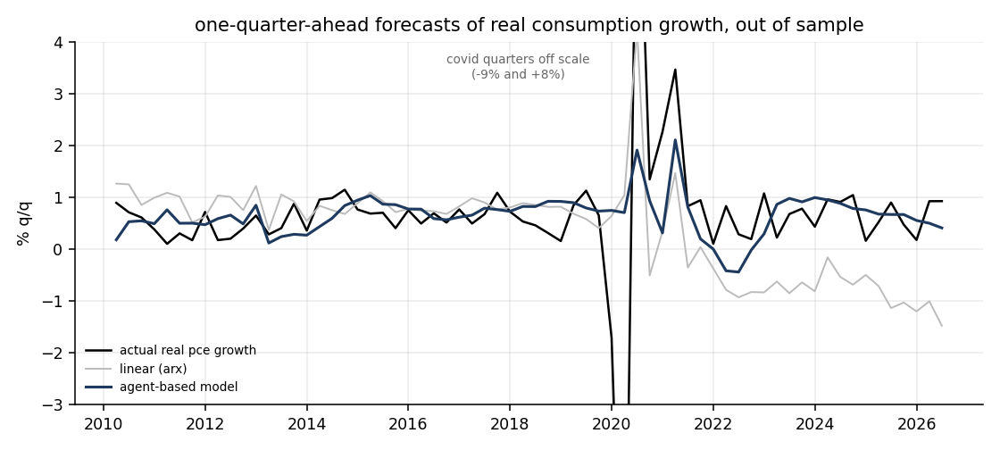
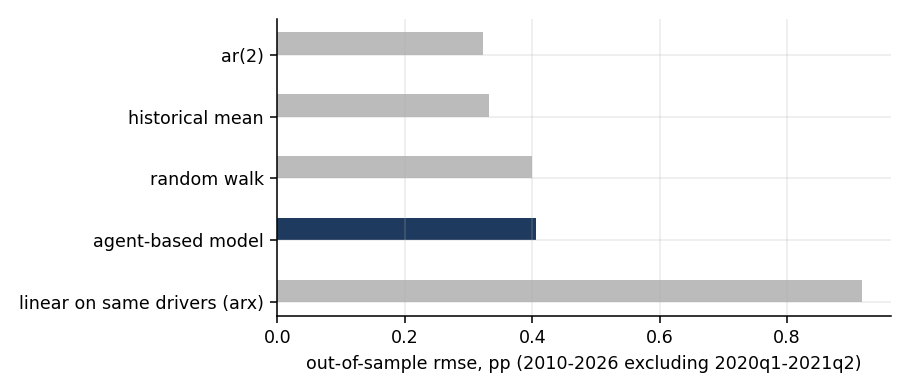
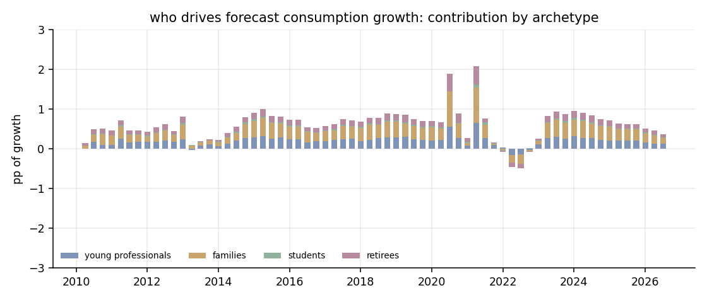
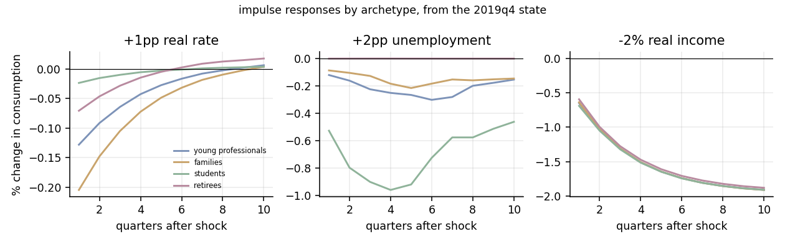
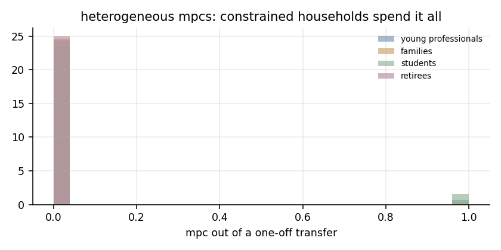

# AI agents for macroeconomics

An agent-based model of US households, split into four demographic archetypes (young professionals, families, students and retirees). It is calibrated on 1980–2009 and used to forecast real consumption growth one quarter ahead from 2010 to 2026. This repo started as a [research plan](PLAN.md) for Wat Street. This is a first working implementation of its core idea: simulate consumers by archetype, aggregate them, and forecast activity.



## Results

Out-of-sample, 66 quarters (2010Q2–2026Q3). "Ex-covid" drops forecasts touching 2020Q1–2021Q2 (59 quarters left). The last column is a Diebold–Mariano test on squared errors, ex-covid; positive t means the agent model is better than that row.

| forecaster | rmse (all) | rmse ex-covid | mae ex-covid | direction ex-covid | dm t vs abm (p) |
|---|---|---|---|---|---|
| ar(2) | 1.82 | 0.32 | 0.28 | 66% | -2.08 (0.04) |
| historical mean | 1.65 | 0.33 | 0.27 | 64% | -1.76 (0.08) |
| random walk | 2.58 | 0.40 | 0.33 | 0% | -0.18 (0.86) |
| **agent-based model** | **1.56** | 0.41 | 0.32 | 64% | – |
| linear on same drivers (arx) | 1.69 | 0.92 | 0.70 | 54% | 3.53 (0.00) |

What this says, plainly:

- **Best on the full sample, COVID included.** The agent model has the lowest RMSE over all 66 quarters. Its unemployment and income channels anticipate the rebound after the 2020Q2 collapse, which pure time-series models cannot do.
- **Not better than naive baselines in calm quarters.** Ex-covid, AR(2) is significantly better (p = 0.04), and the historical mean is close to significantly better (p = 0.08). This matches [Hall (1978)](https://www.jstor.org/stable/1840393): under the permanent income hypothesis, consumption growth is close to unforecastable, and few models beat that.
- **Much better than a linear model on the same information.** The ARX regression sees exactly the drivers the agents see. After 2022 it extrapolates its real-rate coefficient and predicts a long recession that never came (the grey line in the chart above). Building the response out of household budget constraints keeps the agent model from doing that (t = 3.5).



## The model

Each of 20,000 households has an archetype, a permanent income, liquid wealth and an employment status. Every quarter, each household:

1. Updates its belief about trend income growth adaptively. Realised income minus perceived income flows into savings.
2. Becomes employed or unemployed. The odds are tied to the headline unemployment rate and an archetype exposure: students 1.9×, retirees almost none.
3. Earns wages, or unemployment insurance at the replacement rate, plus the real rate on its savings.
4. Sets a target cash buffer. The buffer rises with job-loss fear and with real rates, scaled by an archetype rate sensitivity that stands in for mortgage and credit debt service.
5. Consumes its permanent income plus a fraction of its cash above or below the target, subject to a borrowing limit. Households at the limit are hand-to-mouth.

The archetype multipliers in [`abm/model.py`](abm/model.py) are fixed priors. Six shared behavioural parameters are calibrated by differential evolution on 1980–2009 one-step forecast error, using common random numbers so the objective is smooth. The drivers are real disposable income growth, unemployment, the ex-post real fed funds rate and Michigan sentiment. To forecast quarter t+1 at quarter t, the model copies the household state and steps it under AR(1) forecasts of the drivers, so nothing from t+1 leaks in.

### What the agents do

**Contribution to forecast growth by archetype.** Families and young professionals carry most of it. Retirees matter in the 2020–21 rebound because their income was insulated from job losses.



**Impulse responses from the 2019Q4 household state.** Families respond most to rates. Students respond most to unemployment, through job loss with thin buffers.





## Development log

All three versions are kept in `results/`.

1. **v1** (`table_v1.md`): households set consumption from each quarter's realised income. Ex-covid RMSE was 0.55, worse than every naive baseline. Real consumers smooth, so I added adaptive income expectations and raised the agent count from 4k to 20k to reduce sampling noise.
2. **v2** (`table_v2_inverted.md`): ex-covid RMSE was 0.57. The calibrated measurement layer, an affine map from model growth to measured growth, had a **negative slope**: it scored well by flipping the model's signal upside down. That isn't a forecast, so I discarded it.
3. **v3** (current): the measurement layer is an intercept only, with slope fixed at 1. The intercept came out at +0.05pp, so the model needs almost no bias correction. The numbers in the results table above are from this version.

## Limitations

- **MPCs are too low.** The calibrated spend-down speed hits its lower bound, so the MPC out of a one-off transfer is 0.01–0.09. The empirical literature finds 0.15–0.5. The model gets its fit from smooth consumption and pays for it in transfer responses, so its stimulus-check counterfactuals would be wrong.
- **Sentiment does nothing.** Its calibrated weight is 0. Michigan sentiment adds nothing beyond unemployment and real rates in this setup.
- **National only.** The original plan was regional. The model structure carries over to states (FRED has state income and unemployment), but this version has not done it.
- **Hand-set archetype priors.** The multipliers are reasonable guesses, not estimates. The next step is to estimate them from the Consumer Expenditure Survey micro-data, or to cluster archetypes from it instead of assuming four.

## Reproduce

```bash
pip install -r requirements.txt
python -c "from abm.data import download; download()"   # FRED, no API key needed
python run.py                                          # ~2 min: calibrate, forecast, figures
```
